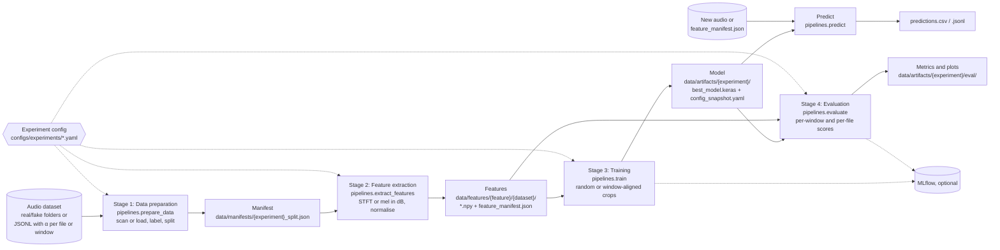

# detector-models

detector-models is a config-driven pipeline for training and evaluating AI music detectors on spectrograms. It covers binary detection (real vs AI audio) and regression of the AI energy ratio α, the energy share of AI-generated stems in a mix, on any dataset of real and AI audio.

For a mix of stems $s_1, \dots, s_n$ where $A$ is the set of AI-generated stems, the AI energy ratio is

$$\alpha = \frac{\sum_{s_i \in A} \mathrm{RMS}(s_i)^2}{\sum_{i=1}^{n} \mathrm{RMS}(s_i)^2}$$

> This repository holds the code used for the ISMIR 2026 paper **[How Much AI Is in This Track? Quantifying the Proportion of AI-Generated Stems in Hybrid Music Mixtures](https://arxiv.org/abs/2608.07285)** and for the author's [MSc thesis](https://zenodo.org/records/23186445).
> Companion website: [fergarciadlc.github.io/ismir26-how-much-ai](https://fergarciadlc.github.io/ismir26-how-much-ai/). The dataset library that builds the hybrid mixtures is [ARIA](https://github.com/fergarciadlc/aria).

## Pipeline



- One experiment YAML composes a dataset, a features and a model config, and owns the training, crop and evaluation settings.
- Each stage is a module in `pipelines/` and a `make` target (`prepare`, `features`, `train`, `evaluate`). `make run-all` runs the four in sequence.
- Outputs land under `data/`: manifests, features, and per-experiment artifacts (model, config snapshot, evaluation).
- MLflow is optional. Leave `MLFLOW_TRACKING_URI` empty to run without it.
- `pipelines.predict` scores new audio with a trained model.

## What it supports

| Area | Options |
|---|---|
| Dataset types | Binary real/fake folders (`binary_classification`). JSONL with α per file (`regression`). JSONL with α per window (`regression`, detected from the rows) |
| Features | `type: stft_magnitude_db` or `mel_spectrogram_db` (needs a `mel` block). Normalisation `fixed` (with `mean`, `std`) or `per_sample`. `audio.hf_cut_hz`. `max_duration_sec` |
| Model outputs | `binary`, `regression`, `multitask` |
| Crop strategies | `random`, `aligned`, `aligned-random` (the last two need window-level JSONL and a `regression` output) |
| Evaluators | Binary, regression, multitask, windowed regression |
| Fine-tuning | `training.pretrained_weights` (path to a `.keras` model, layers copied by name) and `training.freeze_backbone_epochs` |

## Install

Reference setup: Docker, driven by the Makefile.

```bash
cp .env.example .env     # set USER_NAME, BASE_DOCKERFILE, GPU_DEVICE and the dataset paths
make build               # docker build -f $BASE_DOCKERFILE -t genai-audio-detector-$USER_NAME .
make gpu-check           # prints the TensorFlow version and visible GPUs
```

`docker/Dockerfile.gpu` (TensorFlow 2.11 base image) is the reference for the paper: set `BASE_DOCKERFILE=docker/Dockerfile.gpu`. `docker/Dockerfile` is a CPU image (Python 3.11, TensorFlow 2.15 from `pyproject.toml`) and is the default when `BASE_DOCKERFILE` is unset. `.env.example` documents each variable.

The Makefile mounts `./configs` and `./data` into the container and the datasets folder read-only at `/datasets`.

MLflow is optional. `make up` starts a local server from `compose.yaml` (SQLite backend, UI on `http://localhost:${MLFLOW_PORT}`, default 5000) and `make down` stops it.

Local environment without Docker (Python 3.10 or 3.11, TensorFlow 2.15):

```bash
python -m venv .venv && source .venv/bin/activate
pip install -e ".[dev]"
python -m pytest -q
```

The dataset configs use container paths under `/datasets`. A local run needs those paths to exist, for example through symlinks.

## Quick start

```bash
make prepare features train-eval EXP=configs/experiments/exp_music_cnn_mtg.yaml WORKERS=8
```

Stage outputs:

- `data/manifests/{experiment}_split.json` (Stage 1)
- `data/features/{feature}/{dataset}/` with one `.npy` per file in `train/`, `val/`, `test/` and a `feature_manifest.json` (Stage 2)
- `data/artifacts/{experiment}/` with `best_model.keras` and `config_snapshot.yaml` (Stage 3), and `eval/` with metrics, report and plots (Stage 4)

`pipelines.predict` has no make target. Run it with `python -m` in the container, started with the same mounts as the Makefile's `DOCKER_RUN`, or in a local environment where the paths exist:

```bash
docker run --rm --gpus all \
    -v $PWD/configs:/app/configs -v $PWD/data:/app/data \
    -v /path/to/audio:/audio:ro --env-file .env genai-audio-detector-$USER_NAME \
    python -m pipelines.predict \
        --model-path data/artifacts/cnn_mtg_stft_db_44k_fma_medium_encodec/best_model.keras \
        --input /audio --recursive --output-dir data/predictions/my_run
```

`--gpus all` applies on Linux hosts with the GPU image. `--input` accepts a file, a directory or a `.txt` list of paths. Feature parameters come from the `config_snapshot.yaml` next to the model. The output field is `fake_score` for every model type: the mean of the window scores over the file. For regression models it is the mean predicted α. Results go to `predictions.csv` and `predictions.jsonl`.

## Bring your own data

### Binary: real and fake folders

```
my_data/
  real/    # recursive, any depth
  fake/
```

`src/data/scanner.py` scans each folder recursively for `.mp3`, `.wav`, `.flac`, `.ogg`, `.m4a` and `.aac`. `format` restricts the scan to one extension.

```yaml
# configs/datasets/my_data.yaml
dataset:
  name: my_data
  type: binary_classification
  paths:
    real: /datasets/my_data/real
    fake: /datasets/my_data/fake
  format: wav                 # required, filters by extension
  split:
    strategy: stratified
    ratios: [0.70, 0.10, 0.20]   # train / val / test
    seed: 123
```

The split is per file and stratified by class. Features are saved as `{parent}_{stem}.npy` inside each split folder, with no class subfolder (`_npy_filename` in `pipelines/extract_features.py`). Real and fake files therefore need distinct parent/stem names, otherwise their features overwrite each other.

### Regression: α per file

One JSONL row per mix. `mix_path` is relative to the dataset `path`.

```json
{"track_id": "song_001", "mix_path": "mixes/song_001/mix_a.wav", "ai_energy_ratio": 0.37, "split": "train"}
```

```yaml
dataset:
  name: my_mixes
  type: regression
  path: /datasets/my_mixes
  format: wav
  split:
    strategy: predefined
    predefined_path: data/datasets/my_mixes/split.jsonl
```

`src/data/aria_loader.py` reads `track_id`, `mix_path`, `ai_energy_ratio` (or the older `ai_ratio`) and `split` (`train`, `val` or `test`). Use `crop.strategy: random` with this layout.

### Regression: α per window

One JSONL row per window of each mix:

```json
{"track_id": "song_001", "mix_path": "mixes/song_001/mix_a.wav", "split": "train", "window_index": 0, "window_start_sec": 0.0, "window_end_sec": 5.0, "ai_energy_ratio": 0.41, "is_partial": false}
```

The loader detects this layout from `window_start_sec` in the first row. Use it with `crop.strategy: aligned` or `aligned-random` and `model.output.type: regression`, and set `crop.window_sec` to the JSONL window length. A window is used only if it is not partial and fits inside the segment saved in Stage 2 (`start_offset_sec` to `start_offset_sec + duration_sec` in the feature manifest). Set `max_duration_sec` in the features config to choose how much of each mix is extracted. Evaluation writes `eval/windows/` and `eval/tracks/`.

The loader modules are named after ARIA (`aria_loader`, `aria_w5s_loader`) and read any JSONL with these fields. The `create_splits.py` script of [aria](https://github.com/fergarciadlc/aria) writes this format. Regression datasets use the same `.npy` naming as above, with a UUID path component such as the ARIA `track_id` prefixed to the name.

## Configs

```
configs/
  experiments/   one YAML per experiment
  datasets/      dataset configs
  features/      feature configs
  models/        model configs
  _archive/      exploratory configs, kept for reference
```

An experiment config has `experiment` (name, description, optional `limit`, `mlflow_experiment`), the paths `dataset`, `features` and `model` of one config each, and the `training` and `evaluation` blocks. `training` holds epochs, batch size, optimiser, seed, `crop`, callbacks, augmentation and the fine-tuning keys. `src/config.py` resolves the three paths relative to the repository root and builds one `ExperimentConfig`. A dataset, features or model config can be shared by several experiments.

`configs/_archive/` holds exploratory configs for reference only. Their sub-config paths point to pre-archive locations, so they do not load as-is. It also holds the mel features example and the multitask model.

## Reproducing the paper

The binary detector reproduces the CNN of Afchar et al. (2025) and is used as a probe: its fake probability is read as an estimate of α. The regression CNN has the same backbone with a single sigmoid output, trained with mean squared error on the per-window α. The binary models use FMA-Medium and its Encodec 3 kbps reconstruction. The regression models use ARIA, built from MoisesDB with Encodec 3 kbps.

| Paper model | Experiment config | Dataset config | Window | Feature config |
|---|---|---|---|---|
| Binary CNN, 1 s | `configs/experiments/exp_music_cnn_mtg.yaml` | `fma_medium` | 1 s | `stft_db_44k_full` |
| Binary CNN, 5 s | `configs/experiments/exp_music_cnn_mtg_5s.yaml` | `fma_medium` | 5 s | `stft_db_44k_8s` (sliced, see step 2) |
| Regression CNN, 1 s | `configs/experiments/regression_sigmoid_mse_windowed_1s.yaml` | `aria_w1s` | 1 s | `stft_db_44k_60s` |
| Regression CNN, 5 s | `configs/experiments/regression_sigmoid_mse_windowed_5s.yaml` | `aria_w5s` | 5 s | `stft_db_44k_60s` |

The output folders use the feature `name`: `stft_db_44k_full.yaml` has name `stft_db_44k`.

Test-split results from the paper (Table 2, per-mixture scores averaged over windows):

| Model | MAE | RMSE | R² | Pearson |
|---|---|---|---|---|
| Binary CNN, 1 s (α-est.) | 0.228 | 0.289 | -0.193 | 0.617 |
| Binary CNN, 5 s (α-est.) | 0.289 | 0.360 | -0.851 | 0.505 |
| Regression CNN, 1 s | 0.104 | 0.124 | 0.782 | 0.892 |
| Regression CNN, 5 s | 0.076 | 0.102 | 0.854 | 0.925 |

### 1. Build the data

ARIA stems and mixes come from MoisesDB (see the [aria README](https://github.com/fergarciadlc/aria)). Compute the per-window α and the window manifests with the aria scripts:

```bash
# in the aria repository
python scripts/compute_metrics.py --aria-path $ARIA_ROOT --window 5 --output-dir $ARIA_ROOT/metrics/5s
python scripts/create_splits.py --aria-path $ARIA_ROOT \
    --metrics-csv $ARIA_ROOT/metrics/5s/mix_metrics.csv \
    --split-from $ARIA_ROOT/splits/canonical_v2.jsonl \
    --output <this repo>/data/datasets/aria_w5s/canonical_v3.jsonl
```

Repeat with `--window 1` and output `<this repo>/data/datasets/aria_w1s/canonical_v4.jsonl` for the 1 s models. These are the `predefined_path` values of `configs/datasets/aria_w5s.yaml` and `configs/datasets/aria_w1s.yaml`. The paper split must be reused with `--split-from canonical_v2.jsonl`, since it cannot be regenerated from the audio (the aria README explains why).

Place the FMA data at the `paths` of `configs/datasets/fma_medium.yaml`: FMA-Medium (real) and its Encodec 3 kbps rebuild (fake). `DATASETS_DIR` then holds `FMA/fma_medium`, `FMA/fma_medium_rebuilt_mp3_44100_256` and `aria`.

### 2. Extract features

```bash
make prepare features EXP=configs/experiments/regression_sigmoid_mse_windowed_5s.yaml WORKERS=8
make prepare features EXP=configs/experiments/regression_sigmoid_mse_windowed_1s.yaml WORKERS=8
make prepare features EXP=configs/experiments/exp_music_cnn_mtg.yaml WORKERS=8
```

The 5 s binary model needs the third command first, because its features are slices of the 1 s binary features. Slicing reads `data/features/stft_db_44k/fma_medium/feature_manifest.json`:

```bash
python scripts/slice_features_duration.py \
    --src-manifest data/features/stft_db_44k/fma_medium/feature_manifest.json \
    --out-dir data/features/stft_db_44k_8s/fma_medium \
    --feature-name stft_db_44k_8s \
    --keep-sec 8 --min-crop-frames 427 --workers 8
```

### 3. Train and evaluate

```bash
make train-eval EXP=configs/experiments/regression_sigmoid_mse_windowed_5s.yaml
make train-eval EXP=configs/experiments/exp_music_cnn_mtg_5s.yaml
```

The same command applies to the other two configs. `make train` and `make evaluate` run the stages separately, and `MANIFEST=<path>` overrides the feature manifest. Checkpoints go to `data/artifacts/{experiment name}/best_model.keras`. The windowed experiments write `eval/windows/` and `eval/tracks/`, and the Table 2 regression rows are in `eval/tracks/eval_metrics.csv`. The binary experiments write their metrics to `eval/`.

### 4. Binary α-estimate rows

The "α-est." rows apply a binary model to ARIA mixes and compare its fake probability with α. Run these commands in the container (see Quick start) or in a local environment where `/datasets/aria` exists. Copy `canonical_v2.jsonl` from the aria dataset to `data/datasets/aria/splits/` first.

```bash
python - <<'EOF' > data/mixes_test.txt
import json
for line in open("data/datasets/aria/splits/canonical_v2.jsonl"):
    row = json.loads(line)
    if row.get("split") == "test":
        print(f"/datasets/aria/{row['mix_path']}")
EOF

python -m pipelines.predict \
    --model-path data/artifacts/cnn_mtg_stft_db_44k_fma_medium_encodec_5s/best_model.keras \
    --input data/mixes_test.txt --workers 8 --output-dir data/predictions/binary_5s

python scripts/binary_regression_metrics.py \
    --predictions data/predictions/binary_5s/predictions.csv \
    --experiment cnn_mtg_stft_db_44k_fma_medium_encodec_5s \
    --aria-splits data/datasets/aria/splits/canonical_v2.jsonl --split test
```

For the 1 s row use the experiment `cnn_mtg_stft_db_44k_fma_medium_encodec`. The metrics script writes `joined_predictions.csv` and `regression_metrics_vs_aria_targets.csv` in `analysis/` next to the predictions.

### Notes

- **8 s binary features.** `stft_db_44k_8s` comes from slicing the first 8 s of the full-length `stft_db_44k` features. Re-extracting with `max_duration_sec: 8` selects a different start offset and takes the dB reference over the shorter segment, so it gives different features.
- **Evaluation span.** The binary "α-est." rows are scored on whole tracks: `pipelines.predict` averages window scores over the full mix and `binary_regression_metrics.py` compares them with the full-mix α of `canonical_v2`. The regression rows come from `pipelines.evaluate`, which averages window predictions per mix over the 60 s excerpt covered by the `stft_db_44k_60s` features and compares them with the per-window α. The two kinds of row cover different spans of each mix.
- **Deviations from Afchar et al.**
  - The spectrogram is in dB (`librosa.amplitude_to_db`, `ref=np.max`), and the normalisation constants (mean -4, std 3) come from the log10-power setup of the original code.
  - The frame count formula assumes `center=False` and `librosa.stft` uses `center=True`, so windows start about 23 ms early.
  - The binary FMA split is made per file.
  - Silent windows have α = 0, a convention inherited from aria.
- **Environment.** The paper models were trained with `docker/Dockerfile.gpu` (TensorFlow 2.11). `pyproject.toml` pins TensorFlow 2.15 for local use.

## Repository layout

```
configs/      experiments, datasets, features, models, _archive
pipelines/    prepare_data, extract_features, train, evaluate, predict
scripts/      slice_features_duration.py, binary_regression_metrics.py
src/          config, data, features, models, training, evaluation, inference
tests/unit/   unit tests
docker/       Dockerfile (CPU), Dockerfile.gpu (paper)
compose.yaml  optional MLflow server
```

## Citation

If you use this code, please cite the paper ([arXiv:2608.07285](https://arxiv.org/abs/2608.07285)):

```bibtex
@inproceedings{garciadelacruz2026howmuchai,
  title         = {How Much {AI} Is in This Track? Quantifying the Proportion
                   of {AI}-Generated Stems in Hybrid Music Mixtures},
  author        = {Garcia de la Cruz, Fernando and L{\'o}pez-Ayala, David and
                   Zinemanas, Pablo and Molina, Emilio and Rocamora, Mart{\'i}n},
  booktitle     = {Proceedings of the 27th International Society for
                   Music Information Retrieval Conference (ISMIR)},
  address       = {Abu Dhabi, UAE},
  year          = {2026},
}
```

## License

The code is released under the [MIT License](LICENSE).

The CNN architecture follows Afchar, Meseguer-Brocal and Hennequin, "AI-Generated Music Detection and its Challenges" (ICASSP 2025). It is reimplemented from the paper and driven by config files.

The data keep their own licences. MoisesDB is [CC BY-NC-SA 4.0](https://creativecommons.org/licenses/by-nc-sa/4.0/), and FMA tracks carry their own Creative Commons licences.
