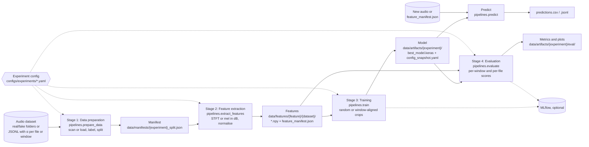

# detector-models

detector-models is a config-driven pipeline for training and evaluating AI music detectors on spectrograms. It covers binary detection (real vs AI audio) and regression of the AI energy ratio α, the energy share of AI-generated stems in a mix, on any dataset of real and AI audio.

For a mix of stems $s_1, \dots, s_n$ where $A$ is the set of AI-generated stems, the AI energy ratio is

$$\alpha = \frac{\sum_{s_i \in A} \mathrm{RMS}(s_i)^2}{\sum_{i=1}^{n} \mathrm{RMS}(s_i)^2}$$

> This repository holds the code used for the ISMIR 2026 paper **[How Much AI Is in This Track? Quantifying the Proportion of AI-Generated Stems in Hybrid Music Mixtures](https://arxiv.org/abs/2608.07285)** and for the author's [MSc thesis](https://zenodo.org/records/23186445).
> Companion website: [fergarciadlc.github.io/ismir26-how-much-ai](https://fergarciadlc.github.io/ismir26-how-much-ai/). The dataset library that builds the hybrid mixtures is [ARIA](https://github.com/fergarciadlc/aria).

## Pipeline



- One experiment YAML composes a dataset, a features and a model config, and owns the training, crop and evaluation settings.
- Each stage is a module in `pipelines/` and a `make` target (`prepare`, `features`, `train`, `evaluate`). `make run-all` runs the four in sequence.
- Outputs land under `data/`: manifests, features, and per-experiment artifacts (model, config snapshot, evaluation).
- MLflow is optional. Leave `MLFLOW_TRACKING_URI` empty to run without it.
- `pipelines.predict` scores new audio with a trained model.

## What it supports

| Area | Options |
|---|---|
| Dataset types | Binary real/fake folders (`binary_classification`). JSONL with α per file (`regression`). JSONL with α per window (`regression`, detected from the rows) |
| Features | `type: stft_magnitude_db` or `mel_spectrogram_db` (needs a `mel` block). Normalisation `fixed` (with `mean`, `std`) or `per_sample`. `audio.hf_cut_hz`. `max_duration_sec` |
| Model outputs | `binary`, `regression`, `multitask` |
| Crop strategies | `random`, `aligned`, `aligned-random` (the last two need window-level JSONL and a `regression` output) |
| Evaluators | Binary, regression, multitask, windowed regression |
| Fine-tuning | `training.pretrained_weights` (path to a `.keras` model, layers copied by name) and `training.freeze_backbone_epochs` |

## Install

Reference setup: Docker, driven by the Makefile.

```bash
cp .env.example .env     # set USER_NAME, BASE_DOCKERFILE, GPU_DEVICE and the dataset paths
make build               # docker build -f $BASE_DOCKERFILE -t genai-audio-detector-$USER_NAME .
make gpu-check           # prints the TensorFlow version and visible GPUs
```

`BASE_DOCKERFILE` selects the GPU image `docker/Dockerfile.gpu` (TensorFlow 2.11, used for the paper) or the CPU image `docker/Dockerfile` (the default). `.env.example` documents each variable.

MLflow is optional. `make up` starts a local server from `compose.yaml` (SQLite backend, UI on `http://localhost:${MLFLOW_PORT}`, default 5000) and `make down` stops it.

Local environment without Docker (Python 3.10 or 3.11, TensorFlow 2.15):

```bash
python -m venv .venv && source .venv/bin/activate
pip install -e ".[dev]"
python -m pytest -q
```

The dataset configs use container paths under `/datasets`. A local run needs those paths to exist, for example through symlinks.

## Quick start

```bash
make prepare features train-eval EXP=configs/experiments/exp_music_cnn_mtg.yaml WORKERS=8
```

Stage outputs:

- `data/manifests/{experiment}_split.json` (Stage 1)
- `data/features/{feature}/{dataset}/` with one `.npy` per file in `train/`, `val/`, `test/` and a `feature_manifest.json` (Stage 2)
- `data/artifacts/{experiment}/` with `best_model.keras` and `config_snapshot.yaml` (Stage 3), and `eval/` with metrics, report and plots (Stage 4)

`pipelines.predict` has no make target. Run it with `python -m` in the container, started with the same mounts as the Makefile's `DOCKER_RUN`, or in a local environment where the paths exist:

```bash
docker run --rm --gpus all \
    -v $PWD/configs:/app/configs -v $PWD/data:/app/data \
    -v /path/to/audio:/audio:ro --env-file .env genai-audio-detector-$USER_NAME \
    python -m pipelines.predict \
        --model-path data/artifacts/cnn_mtg_stft_db_44k_fma_medium_encodec/best_model.keras \
        --input /audio --recursive --output-dir data/predictions/my_run
```

`--input` accepts a file, a directory or a `.txt` list of paths, and feature parameters come from the `config_snapshot.yaml` next to the model. Each file gets a `fake_score`, the mean of its window scores (the mean predicted α for regression models), in `predictions.csv` and `predictions.jsonl`.

## Bring your own data

### Binary: real and fake folders

```
my_data/
  real/    # recursive, any depth
  fake/
```

`src/data/scanner.py` scans each folder recursively for `.mp3`, `.wav`, `.flac`, `.ogg`, `.m4a` and `.aac`. `format` restricts the scan to one extension.

```yaml
# configs/datasets/my_data.yaml
dataset:
  name: my_data
  type: binary_classification
  paths:
    real: /datasets/my_data/real
    fake: /datasets/my_data/fake
  format: wav                 # required, filters by extension
  split:
    strategy: stratified
    ratios: [0.70, 0.10, 0.20]   # train / val / test
    seed: 123
```

The split is per file and stratified by class. Features are saved as `{parent}_{stem}.npy` inside each split folder, with no class subfolder (`_npy_filename` in `pipelines/extract_features.py`). Real and fake files therefore need distinct parent/stem names, otherwise their features overwrite each other.

### Regression: α per file

One JSONL row per mix. `mix_path` is relative to the dataset `path`.

```json
{"track_id": "song_001", "mix_path": "mixes/song_001/mix_a.wav", "ai_energy_ratio": 0.37, "split": "train"}
```

```yaml
dataset:
  name: my_mixes
  type: regression
  path: /datasets/my_mixes
  format: wav
  split:
    strategy: predefined
    predefined_path: data/datasets/my_mixes/split.jsonl
```

`src/data/aria_loader.py` reads `track_id`, `mix_path`, `ai_energy_ratio` (or the older `ai_ratio`) and `split` (`train`, `val` or `test`). Use `crop.strategy: random` with this layout.

### Regression: α per window

One JSONL row per window of each mix:

```json
{"track_id": "song_001", "mix_path": "mixes/song_001/mix_a.wav", "split": "train", "window_index": 0, "window_start_sec": 0.0, "window_end_sec": 5.0, "ai_energy_ratio": 0.41, "is_partial": false}
```

The loader detects this layout from `window_start_sec` in the first row. Use it with `crop.strategy: aligned` or `aligned-random`, `model.output.type: regression`, and `crop.window_sec` equal to the JSONL window length. Only windows inside the segment extracted in Stage 2 (`max_duration_sec`) are used. Evaluation writes per-window results to `eval/windows/` and per-mix results to `eval/tracks/`.

The loaders (`aria_loader`, `aria_w5s_loader`) read any JSONL with these fields. The `create_splits.py` script of [aria](https://github.com/fergarciadlc/aria) writes this format.

## Configs

```
configs/
  experiments/   one YAML per experiment
  datasets/      dataset configs
  features/      feature configs
  models/        model configs
  _archive/      exploratory configs, kept for reference
```

An experiment config points to one dataset, features and model config and holds the `training` and `evaluation` settings; `src/config.py` composes them. `configs/_archive/` keeps exploratory configs (mel features, multitask models) for reference; they do not load as-is.

## Paper experiments

The four experiments of the ISMIR 2026 paper are `exp_music_cnn_mtg` and `exp_music_cnn_mtg_5s` (binary, 1 s and 5 s) and `regression_sigmoid_mse_windowed_1s` and `regression_sigmoid_mse_windowed_5s` (regression, 1 s and 5 s) in `configs/experiments/`. [REPRODUCING.md](REPRODUCING.md) describes how to build their data and run them.

## Citation

If you use this code, please cite the paper ([arXiv:2608.07285](https://arxiv.org/abs/2608.07285)):

```bibtex
@inproceedings{garciadelacruz2026howmuchai,
  title         = {How Much {AI} Is in This Track? Quantifying the Proportion
                   of {AI}-Generated Stems in Hybrid Music Mixtures},
  author        = {Garcia de la Cruz, Fernando and L{\'o}pez-Ayala, David and
                   Zinemanas, Pablo and Molina, Emilio and Rocamora, Mart{\'i}n},
  booktitle     = {Proceedings of the 27th International Society for
                   Music Information Retrieval Conference (ISMIR)},
  address       = {Abu Dhabi, UAE},
  year          = {2026},
}
```

## License

The code is released under the [MIT License](LICENSE).

The CNN architecture follows Afchar, Meseguer-Brocal and Hennequin, "AI-Generated Music Detection and its Challenges" (ICASSP 2025). It is reimplemented from the paper and driven by config files.

The data keep their own licences. MoisesDB is [CC BY-NC-SA 4.0](https://creativecommons.org/licenses/by-nc-sa/4.0/), and FMA tracks carry their own Creative Commons licences.
