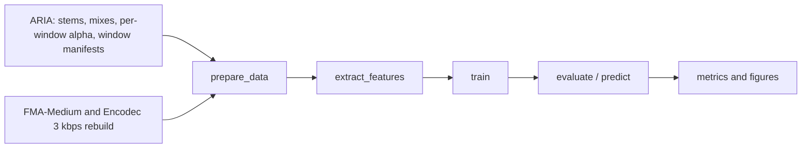

# detector-models

> This repository holds the code used for the ISMIR 2026 paper **[How Much AI Is in This Track? Quantifying the Proportion of AI-Generated Stems in Hybrid Music Mixtures](https://arxiv.org/abs/2608.07285)** and for the author's [MSc thesis](https://zenodo.org/records/23186445).
> Companion website: [fergarciadlc.github.io/ismir26-how-much-ai](https://fergarciadlc.github.io/ismir26-how-much-ai/). The dataset library that builds the hybrid mixtures is [ARIA](https://github.com/fergarciadlc/aria).

TensorFlow/Keras code to train and evaluate the two kinds of model in the paper, both built on the same spectrogram CNN:

- **Binary detector.** A reproduction of the CNN of Afchar et al. (2025), trained on FMA-Medium and its Encodec 3 kbps reconstruction. The paper uses it as a probe: its fake probability is read as an estimate of the AI energy ratio.
- **Regression CNN.** The same backbone with a single sigmoid output trained with mean squared error to predict the AI energy ratio α of a window of a hybrid mix.

For a mix of stems $s_1, \dots, s_n$ where $A$ is the set of AI-generated stems, the AI energy ratio is

$$\alpha = \frac{\sum_{s_i \in A} \mathrm{RMS}(s_i)^2}{\sum_{i=1}^{n} \mathrm{RMS}(s_i)^2}$$

Every stage is driven by YAML configs (dataset, features, model, experiment) in `configs/`, and each stage has a command-line entry point in `pipelines/`.



## Install and environment

Reference setup: Docker with the GPU image, driven by the Makefile.

```bash
cp .env.example .env     # set USER_NAME, BASE_DOCKERFILE, GPU_DEVICE and the dataset paths
make build               # docker build -f $BASE_DOCKERFILE -t genai-audio-detector-$USER_NAME .
make gpu-check           # prints the TensorFlow version and visible GPUs
```

The paper models were trained with `docker/Dockerfile.gpu` (TensorFlow 2.11 base image). Select it in `.env` with `BASE_DOCKERFILE=docker/Dockerfile.gpu`. `docker/Dockerfile` is a CPU image (Python 3.11, TensorFlow 2.15 from `pyproject.toml`) and is the default when `BASE_DOCKERFILE` is unset.

`.env` variables used by the Makefile:

| Variable | Meaning |
|---|---|
| `USER_NAME` | Suffix of the image tag |
| `BASE_DOCKERFILE` | Dockerfile used by `make build` |
| `GPU_DEVICE` | `all` or a device list such as `0` or `0,1` (Linux only) |
| `DATASETS_DIR` | Host folder mounted read-only at `/datasets`. The paper configs expect `FMA/fma_medium`, `FMA/fma_medium_rebuilt_mp3_44100_256` and `aria` inside it |
| `DATASETS_REAL_DIR`, `DATASETS_FAKE_DIR` | Alternative mounts at `/datasets/real` and `/datasets/fake`. They replace `DATASETS_DIR` when set |
| `MLFLOW_TRACKING_URI` | Tracking server URL. Empty disables MLflow |
| `MLFLOW_PORT`, `MLFLOW_EXPERIMENT_NAME`, `MLFLOW_RUN_USER` | Optional MLflow settings |

The Makefile mounts `./configs` and `./data` into the container. Features, manifests, checkpoints and evaluation outputs are written under `./data`.

MLflow is optional. `make up` starts a local server from `compose.yaml` (SQLite backend, UI on `http://localhost:${MLFLOW_PORT}`, default 5000) and `make down` stops it.

Local environment without Docker (Python 3.10 or 3.11, TensorFlow 2.15):

```bash
python -m venv .venv && source .venv/bin/activate
pip install -e ".[dev]"
python -m pytest -q
```

The dataset configs use the container paths under `/datasets`. A local run needs those paths to exist, for example through symlinks.

## Reproducing the paper

| Paper model | Experiment config | Data | Window | Features | Commands |
|---|---|---|---|---|---|
| Binary CNN, 1 s | `configs/experiments/exp_music_cnn_mtg.yaml` | FMA-Medium vs Encodec 3 kbps rebuild (`fma_medium`) | 1 s | `stft_db_44k_full` | `make prepare features train-eval EXP=<config>` |
| Binary CNN, 5 s | `configs/experiments/exp_music_cnn_mtg_5s.yaml` | `fma_medium` | 5 s | `stft_db_44k_8s` (sliced, see step 2) | slice features, then `make train-eval EXP=<config>` |
| Regression CNN, 1 s | `configs/experiments/regression_sigmoid_mse_windowed_1s.yaml` | ARIA 1 s windows (`aria_w1s`) | 1 s | `stft_db_44k_60s` | `make prepare features train-eval EXP=<config>` |
| Regression CNN, 5 s | `configs/experiments/regression_sigmoid_mse_windowed_5s.yaml` | ARIA 5 s windows (`aria_w5s`) | 5 s | `stft_db_44k_60s` | `make prepare features train-eval EXP=<config>` |

Test-split results from the paper (Table 2, per-mixture scores averaged over windows):

| Model | MAE | RMSE | R² | Pearson |
|---|---|---|---|---|
| Binary CNN, 1 s (α-est.) | 0.228 | 0.289 | -0.193 | 0.617 |
| Binary CNN, 5 s (α-est.) | 0.289 | 0.360 | -0.851 | 0.505 |
| Regression CNN, 1 s | 0.104 | 0.124 | 0.782 | 0.892 |
| Regression CNN, 5 s | 0.076 | 0.102 | 0.854 | 0.925 |

### 1. Build the ARIA data with aria

Follow the [aria README](https://github.com/fergarciadlc/aria) to build stems and mixes from MoisesDB, then compute the per-window α and the window manifests with the aria scripts:

```bash
# in the aria repository
python scripts/compute_metrics.py --aria-path $ARIA_ROOT --window 5 --output-dir $ARIA_ROOT/metrics/5s
python scripts/create_splits.py --aria-path $ARIA_ROOT \
    --metrics-csv $ARIA_ROOT/metrics/5s/mix_metrics.csv \
    --split-from $ARIA_ROOT/splits/canonical_v2.jsonl \
    --output <this repo>/data/datasets/aria_w5s/canonical_v3.jsonl
```

Repeat with `--window 1` and output `<this repo>/data/datasets/aria_w1s/canonical_v4.jsonl` for the 1 s models. These are the paths in `configs/datasets/aria_w5s.yaml` and `configs/datasets/aria_w1s.yaml`. Put the aria dataset at `$DATASETS_DIR/aria`.

The paper split must be reused with `--split-from canonical_v2.jsonl`. It cannot be regenerated from the audio. The aria README explains why.

The binary models use FMA-Medium (real) and its Encodec 3 kbps reconstruction (fake), following Afchar et al. Place them at the `paths` of `configs/datasets/fma_medium.yaml`.

### 2. Extract features

```bash
make prepare  EXP=configs/experiments/regression_sigmoid_mse_windowed_5s.yaml
make features EXP=configs/experiments/regression_sigmoid_mse_windowed_5s.yaml WORKERS=8
```

Features are written to `data/features/{feature_name}/{dataset_name}/` with a `feature_manifest.json`. The 1 s binary model uses the full-length features:

```bash
make prepare features EXP=configs/experiments/exp_music_cnn_mtg.yaml WORKERS=8
```

The 5 s binary model uses `stft_db_44k_8s`, made by slicing the first 8 s of those full-length features:

```bash
python scripts/slice_features_duration.py \
    --src-manifest data/features/stft_db_44k/fma_medium/feature_manifest.json \
    --out-dir data/features/stft_db_44k_8s/fma_medium \
    --feature-name stft_db_44k_8s \
    --keep-sec 8 --min-crop-frames 427 --workers 8
```

### 3. Train and evaluate

```bash
make train-eval EXP=configs/experiments/regression_sigmoid_mse_windowed_5s.yaml
make train-eval EXP=configs/experiments/exp_music_cnn_mtg_5s.yaml
```

`make train` and `make evaluate` run the stages separately. `MANIFEST=<path>` overrides the feature manifest, and `make run-all` runs prepare, features, train and evaluate in sequence. Checkpoints go to `data/artifacts/{experiment name}/best_model.keras` and evaluation outputs (metrics CSV, plots) to `data/artifacts/{experiment name}/eval/`. The same commands apply to the other three configs.

### 4. Binary α-estimate rows

The "α-est." rows of Table 2 apply a binary model to ARIA mixes and compare its fake probability with α. `pipelines.predict` has no Makefile target. Run it in the container or in the local environment:

Copy `canonical_v2.jsonl` from the aria dataset to `data/datasets/aria/splits/` first.

```bash
# list the test-split mixes of the paper manifest
python - <<'EOF' > data/mixes_test.txt
import json
root = "/datasets/aria"
for line in open("data/datasets/aria/splits/canonical_v2.jsonl"):
    row = json.loads(line)
    if row.get("split") == "test":
        print(f"{root}/{row['mix_path']}")
EOF

python -m pipelines.predict \
    --model-path data/artifacts/cnn_mtg_stft_db_44k_fma_medium_encodec_5s/best_model.keras \
    --input data/mixes_test.txt --workers 8 \
    --output-dir data/predictions/binary_5s

python scripts/binary_regression_metrics.py \
    --predictions data/predictions/binary_5s/predictions.csv \
    --experiment cnn_mtg_stft_db_44k_fma_medium_encodec_5s \
    --aria-splits data/datasets/aria/splits/canonical_v2.jsonl --split test
```

Use the 1 s model and experiment name `cnn_mtg_stft_db_44k_fma_medium_encodec` for the 1 s row. `binary_regression_metrics.py` writes `joined_predictions.csv` and `regression_metrics_vs_aria_targets.csv` next to the predictions, in `analysis/`.

## Repository layout

```
configs/
  experiments/     the 4 paper experiments
  datasets/        fma_medium, aria_w1s, aria_w5s
  features/        stft_db_44k_full, stft_db_44k_8s, stft_db_44k_60s
  models/          spec_cnn_v1 (binary), spec_cnn_regression_v1
  _archive/        exploratory configs not used in the paper
pipelines/         prepare_data, extract_features, train, evaluate, predict
scripts/           slice_features_duration.py, binary_regression_metrics.py
src/               config, data, features, models, training, evaluation, inference
tests/unit/        unit tests
docker/            Dockerfile (CPU), Dockerfile.gpu (paper)
compose.yaml       optional MLflow server
```

Each experiment config references one dataset, one feature and one model config and owns the training, crop and evaluation settings.

## Notes on reproduction

- **8 s binary features.** `stft_db_44k_8s` comes from slicing the first 8 s of the full-length `stft_db_44k` features with `scripts/slice_features_duration.py`. Re-extracting with `max_duration_sec: 8` selects a different start offset and takes the dB reference over the shorter segment, so it does not reproduce them.
- **Evaluation span.** The binary "α-est." rows are scored on whole tracks. `pipelines.predict` averages window scores over the full mix, and `binary_regression_metrics.py` joins them to the per-mix α of `canonical_v2` (full-mix α). The regression rows come from `pipelines.evaluate` with the windowed evaluator, which averages window predictions per mix over the 60 s excerpt covered by the `stft_db_44k_60s` features and compares them with the per-window α. The two kinds of row therefore cover different spans of each mix.
- **Known deviations from Afchar et al.**
  - The spectrogram is in dB (`librosa.amplitude_to_db`, `ref=np.max`), while the normalisation constants (mean -4, std 3) come from the log10-power setup of the original code.
  - The frame count formula assumes `center=False`, while `librosa.stft` uses `center=True`, so windows start about 23 ms early.
  - The binary FMA split is made per file.
  - Silent windows have α = 0, a convention inherited from aria.
- **Environment.** The paper models were trained with `docker/Dockerfile.gpu` (TensorFlow 2.11). `pyproject.toml` pins TensorFlow 2.15 for local use.

## Citation

If you use this code, please cite the paper ([arXiv:2608.07285](https://arxiv.org/abs/2608.07285)):

```bibtex
@inproceedings{garciadelacruz2026howmuchai,
  title         = {How Much {AI} Is in This Track? Quantifying the Proportion
                   of {AI}-Generated Stems in Hybrid Music Mixtures},
  author        = {Garcia de la Cruz, Fernando and L{\'o}pez-Ayala, David and
                   Zinemanas, Pablo and Molina, Emilio and Rocamora, Mart{\'i}n},
  booktitle     = {Proceedings of the 27th International Society for
                   Music Information Retrieval Conference (ISMIR)},
  address       = {Abu Dhabi, UAE},
  year          = {2026},
}
```

## License

The code is released under the [MIT License](LICENSE).

The CNN architecture follows Afchar, Meseguer-Brocal and Hennequin, "AI-Generated Music Detection and its Challenges" (ICASSP 2025). It is reimplemented from the paper and driven by config files.

The data keep their own licences. MoisesDB is [CC BY-NC-SA 4.0](https://creativecommons.org/licenses/by-nc-sa/4.0/), and FMA tracks carry their own Creative Commons licences.
